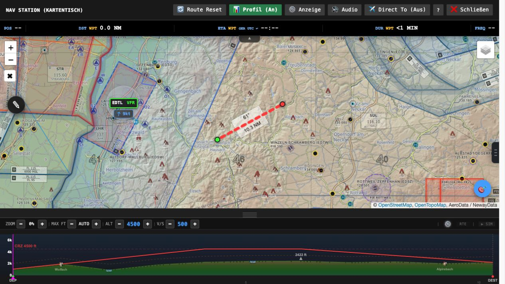
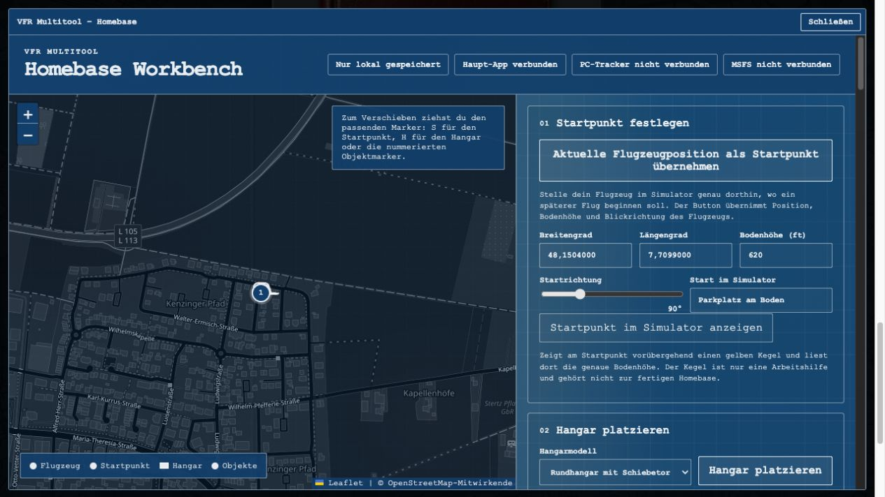

# VFR Multitool

The VFR Multitool accompanies your VFR flights in Microsoft Flight Simulator: from the flight idea through planning and missions to the live map in the cockpit. This guide explains the larger features and how to use them.

**As of: 27 October 2026 · Origin / Alpha.** This guide describes the Origin version. Stable may offer a different feature set. The release notes in the app and the tracker are authoritative.

[Open Multitool](index.html) · [Welcome](welcome.html) · [Guided setup](setup.html) · [Deutsche Anleitung](readme.html)

The tool is meant for the flight simulator. Maps, weather and warnings are not a basis for real-world flights.

**Language note:** the interface can be switched to English under **Settings**. Missions, briefings, passenger voices, the Windows tracker and the screenshots are still German for now. Tracker labels are quoted in German with the English meaning in brackets.

## 1. Quick start and orientation

You can use the Multitool in three ways:

- **Plan:** choose departure, destination and aircraft, view the briefing, edit and export the route. This already works in the browser.
- **Fly freely:** set your own destination on the map table with **Direct To**. With the tracker, the map follows your aircraft; no mission is needed.
- **Fly a mission:** generate, review and accept a job. For the actual mission flow in the simulator you need the connected Windows tracker.

### Your first job

1. Enter your departure airfield under **Start / DEP**, for example `EDTW`, and pick the matching search result.
2. Choose an aircraft preset or set speed, fuel flow, cruise altitude and climb/descent rate.
3. Choose mission type, distance and direction. An empty destination lets the dispatcher search.
4. Click **Generate job / DISPATCH**. Review the briefing and choose **Accept mission**.
5. Connect tracker and MSFS. With the EFB package installed you can already open the VFR Multitool in the EFB on the **world map** and send the prepared flight to the simulator’s flight planning. Check the takeover and load the flight in the simulator.
6. Stand on the ground in the loaded cockpit and choose **Start mission** on the map table.
7. Work through the steps shown for boarding, loading and the job.

For the complete first-time setup use the [setup page](setup.html). This guide is for looking things up afterwards.

### Where do I find what?

- **Main page:** dispatch, aircraft presets, briefing, logbook, Homebase and settings.
- **Map table:** route, live position, elevation profile, display and audio menu as well as tools.
- **Side menu on the map table:** checklists, mission, weather, radio, warnings, airfield information, nearest and cargo.
- **Windows tracker:** connection, audio output, autostart, updates and add-on packages.
- **MSFS 2024 EFB and toolbar:** cockpit access to map, mission and tools via the running tracker.

## 2. Setting up pilot ID, cloud and AI

### Pilot ID and cloud sync

**Here:** main page → **Settings** → **Pilot Identity & Sync**.

The pilot ID is your shared profile. A **PIN of 4 to 8 digits** protects access.

1. Enter your own, unique pilot ID and a PIN.
2. Click **Login**. A still free ID is registered this way; for an existing ID you need its PIN.
3. Enable **Auto-Sync** if saved content should be matched automatically.
4. Use the same ID and PIN on tablet, second device and in the tracker.

**Push** writes the current state to the cloud. **Pull** fetches the cloud state to the device. If states differ, first check which device holds the data you want.

With auto-sync enabled, newly created drafts and accepted jobs are saved across devices. An upload that has not been confirmed yet stays queued and is retried. A reloaded briefing is not automatically a started mission.

### AI for briefings

**Here:** Settings → **AI Dispatcher**.

The optional AI adds individual briefings, passengers, cargo and backgrounds to jobs. Without AI, map planning and locally generated jobs remain available.

- **Provider:** Gemini or ChatGPT (OpenAI). The key must belong to the chosen provider.
- **API key:** enter it in the field shown for Gemini or OpenAI and check the status message.
- **AI on/off:** decides whether the AI is used.
- **Profile:** Auto, economical, quality or high quality. Auto suits the start; the economical profile is meant for frequent trying out.

You create Gemini keys in [Google AI Studio](https://aistudio.google.com/apikey), OpenAI keys on the [OpenAI platform](https://platform.openai.com/api-keys). Official help: [Gemini API keys](https://ai.google.dev/gemini-api/docs/api-key) and [OpenAI API quickstart](https://developers.openai.com/api/docs/quickstart).

The providers handle quotas and billing. AI briefings and AI voices can cause separate usage. Check the usage with the provider; a chat login alone does not replace an API key.

### Why enter keys and sign-in again in the tracker?

The **pilot ID + PIN** assign the connection to your pilot. The **web API key** enables AI briefings in the respective browser. The **voice key in the tracker** enables the central AI speech output, also for EFB and toolbar.

Browser and tracker store these accesses separately. The web key is not synced via your pilot profile. On another web device you enter it again. The start dialog offers to remember it for further visits on this device; local website storage is not encrypted. The tracker protects its stored voice key with your Windows account.

Do not share PIN and API keys via pinboards or screenshots. The content needed for AI requests is sent to your chosen provider.

## 3. Aircraft, appearance and airfield search

### Aircraft presets

You can create up to 10 aircraft presets. The three preset buttons on the main page and in the NavCom are quick-select slots (initially C172, Comanche and Aerostar). A click selects the preset on the button; right-click or long press opens a list from which you assign a different preset to the button. You create, edit and delete presets under **Settings → Aircraft / Presets**: **+** creates a new one, a click on a preset opens the editor.

- **TAS:** planned cruise speed in knots; affects flight time and planning.
- **GPH:** planned fuel flow in US gallons per hour; basis of the fuel estimate.
- **Cruise ALT:** desired cruise altitude for route, profile and hints.
- **V/S:** planned climb/descent rate for the climb and descent profile.
- **Seats, payload and aircraft class:** help the dispatcher choose matching jobs and loads.
- **Mission profiles:** for example private/travel, charter, cargo, utility, bush/STOL or training. They limit the automatic random rotation; a specific mission remains selectable.

If times or cargo amounts don’t fit, check the aircraft values first. Boarding door and relative waypoints can be adjusted per preset if the scene in the simulator doesn’t match the aircraft.

### Interfaces and sizes

Under **Settings → Appearance** you can choose Modern, Analog, NavCom, Ops 1940 and Win95. They operate the same basic data.

- **Analog:** a mechanical-looking panel. The screw at the top right changes the design (classic, tower, teleprinter), the screw at the top left the paint.
- **NavCom:** radio stack with rotary knobs and DATA and DISPATCH controls. The screw at the top right changes the design (classic, Bendix, KX); you change the display colour via O/M/I, the TEST key or, on the KX, via PULL TEST.
- **Ops 1940:** instrument-style mission selection and briefing display.
- **Win95:** window and desktop design in the classic PC style.

In Analog and NavCom the **glareshield** forms the top edge of the panel: swiping sideways changes the material, dragging up or down at the outside bends it, dragging down in the middle opens a design list.

Use **page size** to adapt the controls to tablet, monitor or VR. Clock and media skins can be chosen independently. On iPad/iPhone you can add the web app to the home screen via Safari.

### Searching and saving airfields

Departure and destination can be selected by identifier, name and search suggestions. The self-hosted data covers airfields worldwide, including ones without a classic ICAO code. With similar names, check the place shown and pick the result deliberately.

With the **star** in the airfield search you save favourites. They appear when you open a matching field and are offered first in the results. There are favourite stars on the map too; their display can be switched under **Display → Favourites**.

The **airfield types** filter limits the offered and automatically chosen fields. For civil heliports, **Heli** must be enabled explicitly. Different departure/destination types can be combined by selecting several categories.

## 4. Dispatch and mission types

### Random, suggestions or your own destination

- **Empty destination / RNDM / ----:** the dispatcher searches for a destination.
- **Set a destination:** plan a specific connection, as far as it fits the chosen profile.
- **RDM:** generate randomly right away.
- **PICK:** see suggestions first and have one of them worked out.
- **Distance and direction:** narrow the search area. Very tight settings can limit the choice a lot.
- **Region:** where offered in the chosen view, narrow down between regional and international destinations.

The aircraft values and the chosen mission profile influence the selection. A draft can be reviewed before you accept it.

### Airfield, POI and bush jobs

**APT** usually leads from one airfield to another: club, private, charter, cargo, training, medical transfer, fragile cargo, animal transport, reporter or sightseeing.

**POI** puts a task at a place at the centre: training, infrastructure inspection, chain survey, photo/film, mapping/survey, reporter, sightseeing, learning guide, historian, bio/environment, geo/relief, SAR/rescue or fire watch.

**Bush** stands for remote landing sites and backcountry flights: supply, charter, adventure, exploration with return as well as passenger or cargo pickup with return flight.

You can also search by target categories such as bridges, roads, dams, radio masts, industry, castles, waters, mountains or towns. **Free flight/planning** delivers a planning route without a mission flow.

### What does a job require?

Read the specific briefing: a photo task is different from a visual inspection, an area survey or a pickup. Not every POI flight requires a photo, not every job ends at the first destination and not every mission carries passengers.

Training, mapping and other work jobs may require certain altitudes, areas, times or individual confirmations. You find the current conditions during the flight in **Mission Control**.

## 5. Briefing and flight plan handover

### What is in the briefing?

- **Job:** title, background, passengers, cargo, distance, course and estimated flight time.
- **Nav log:** waypoints, frequencies, courses, distances, times and fuel estimate.
- **Departure and destination:** available runway, weather, frequency, AIP and place information.
- **Elevation profile:** terrain, altitude planning and available hints along the route.

In the nav log the airspace filter can limit the warnings to your planned altitude. A source link helps to open additional airfield or weather information.

### Flight code, PDF and MSFS file

Via **DATA / 💾 / Transfer** you can copy or load flight codes and import MSFS flight plans or export them as `.pln`. The PDF function creates a briefing to take along or print.

Accept a mission draft before you pin, share or pass it on for the flight. A pure planning import is not yet a started job.

### Load via the EFB already on the world map

You can take over the prepared flight already on the **MSFS 2024 world map**:

1. Prepare the job in the Multitool and choose **Accept mission**.
2. Keep the tracker running and open the **VFR Multitool in the EFB** on the world map. The EFB package must be installed for this.
3. In the planning note, choose to send the flight plan to ATC. Wait for the confirmation and check the start position and aircraft in the simulator.
4. Load the flight in the simulator. As soon as you are ready on the ground in the cockpit, choose **Start mission**.

This brings the planning into the simulator before you even enter the cockpit. The world map transfer alone does not start a mission and does not load passengers or cargo.

### Send directly to MSFS and avionics

With a matching tracker and cockpit package you can also send the route from the EFB or the toolbar to the **simulator’s flight planning**. The planning notes offer the matching transfer path. A closed planning banner can be brought back via the toolbar.

Mission Control offers the transfer to **MSFS** as well as to **MSFS and avionics**. For the avionics, switch the device on and let it boot first. Not every aircraft takes over a plan in the same way; look at the confirmation and check the route in the device.

If the confirmation of the takeover is missing, don’t assume the transfer succeeded.

## 6. Mission, passengers and loading

### Starting and finding the next step

After **Accept mission** the job is prepared. In normal simulator operation the **tracker** runs the mission flow; web app, EFB and toolbar show the same state and the actions allowed there.

1. Connect the tracker and load the cockpit completely.
2. Stop on the ground and choose **Start mission**.
3. Carry out boarding and loading as instructed.
4. Only set off on the actual flight after clearance.

**Mission Control** in the side menu of the map table shows task, phase, distance, working altitude, working time or area/chain progress. Added to that are mandatory conditions, passenger mood, cargo state and deviation hints.

### Load manager

The load manager bundles **loading**, **pickup** and **unloading**. It shows the people and items relevant to the current station as well as what is on board.

1. Load, pick up or unload mandatory items at the right destination.
2. **Sign** the list and wait for the signature.
3. Then **confirm** the loading separately.

A change after signing requires a new signature. A departure signature does not automatically apply to pickup or arrival. Closing the window does not discard the edited state. You can reopen the dialog via the cargo area.

Loading is locked in the simulator menu and on the world map. If a job doesn’t continue, check mandatory items, signature and confirmation as well as the next expected action.

### Boarding, baggage and arrival

Depending on the job, people, baggage, cargo and matching scenes appear in the simulator. Boarding and disembarking are part of the flow; an open target point alone does not complete a pickup.

For pickup jobs a return flight may follow after loading. On arrival the intended items and people must be handed over before completion and debrief are released. Wait for ongoing boarding/disembarking actions or farewell announcements.

Passenger texts and optional voices accompany the mission phase and flying behaviour. Available conversation and task actions appear in the mission/passenger areas. New entries may be marked by a hint; you don’t need to keep all areas open all the time.

### On-board equipment and aircraft log

Aircraft log, first-aid kit, fire extinguisher and wheel chocks can be managed on the ground at a standstill, also independently of a mission. They are separate from the mandatory mission baggage. Items left behind can count as lost after departure.

The **aircraft log** belongs to the equipment carried. The red **logbook on the main page**, on the other hand, shows completed flights and their evaluation.

## 7. Interrupting, resuming and logbook

### Resuming a running job

After a simulator disconnect or a tracker restart, the running mission state can be kept. The interface shows a saved or interrupted job; boarding and loading actions wait in the meantime.

Start MSFS again and load a flight. In the current flow, resuming is the normal case: the loaded cockpit picks the mission up again as soon as the conditions at the save point are met. Short connection interruptions can recover on their own.

- **Interruption on the ground:** park the aircraft at the departure, destination or save point shown and let it stand still briefly.
- **Interruption in the air:** fly to the marked zone and keep flying normally for the time shown. If offered, you can be moved to the save point.

### Resuming a saved flight via the world map

You can also prepare a saved, interrupted flight again on the **world map**:

1. Start the tracker and open the **VFR Multitool in the EFB** on the MSFS 2024 world map.
2. On the interrupted job, choose to load the save point as soon as the action is offered. This hands the re-entry to the simulator’s flight planning; after an interruption in the air this can be an air start at the save point.
3. Note the confirmation and hints, choose the matching aircraft and load the flight in the simulator.
4. Follow the resume hints in the cockpit. As soon as the conditions at the save point are met, your previous job continues. If needed, then load the flight plan into the avionics.

You don’t need to create a new job or reset the mission for this.

A world map position sent for re-entry and the route for the avionics serve different purposes. Check the start position and then the flight plan in the cockpit. A save point does not load a particular aircraft model by itself.

### Resume or restart?

**Resume** is meant to keep your running job. **Restart / reset mission** begins the flow again; **cancel** ends the job. Don’t choose reset just because the tracker is temporarily missing.

Jobs that are planned and accepted but not started have no age limit. The browser recovery of a started job and the stored tracker run are different backups; follow the tracker status currently shown. A browser time limit is not a general expiry date for every tracker save point.

### Completion and debrief

Once the job is done and the handover completed, **Completion & debrief** or **End mission** becomes available. The evaluation shows the recorded flight data; for multi-part flights, the existing segments are merged for the mission evaluation.

The final mission completion writes the entry to the logbook automatically. An intermediate stop is not yet the final mission completion.

### The red logbook

Open the red leather logbook on the main page. It shows date, aircraft, route, duration, distance and a job note. You page with the side buttons; an existing entry opens its details or the debrief.

Clearing the whole logbook is a separate action with confirmation. Pure Direct To flights have no mission completion and are therefore not automatically the same as a logged mission flight.

## 8. Map table, route and radio

### The map day to day

The **map table** works with a job, an imported route and free flight. The full-screen icon gives the map more room. On small displays you can collapse the upper toolbar.

- Move, add and remove waypoints; **Route Reset** undoes manual changes.
- **Snapping** helps to snap to airfields, navaids and reporting points.
- **Auto-follow** follows your live position; **auto-zoom** adjusts the view with look-ahead.
- Route bar, telemetry, current position and waypoint info can be shown under **Display**.
- You choose map styles and layers in the map menu. Availability and display differ between browser and cockpit.

In the browser there are also the reduced OpenFreeMap styles **Positron (light)**, **Dark** and **Fiord**. They need WebGL and internet. EFB and toolbar use their supported raster base maps; a browser map choice does not automatically mean the same map style there.

### Direct To without a job

1. Open the map table and switch on **Direct To**.
2. Choose an airfield or a map point as the destination.
3. With live GPS the connection starts at your current position; otherwise an existing planning start is used.

No boarding, cargo or mission start is needed for this. For story, tasks, pickups and mission scenes, choose a real dispatch.

### Taking over radio and frequencies

The radio area offers available frequencies for route and airfields; the waypoint info supports orientation towards the next leg. ATIS can be shown too when the data is available.

Under **Display → NAVCOM** you decide how offered frequencies are operated:

- **OFF:** no direct radio takeover.
- **Device 1 active:** direct takeover to the first matching device.
- **Selection:** choose target device and, where available, active or standby deliberately.

With a matching tracker, supported COM, NAV, ADF and transponder values can be transferred to the simulator. Check the feedback and the actual device; not every individual aircraft avionics supports all standard functions.

The NAVCOM operating mode is synced with your profile. Changing the operating mode alone does not change a frequency.

### Nearest and airfield information

**Nearest** searches for nearby airfields using the live position. **Airfield** bundles available departure/destination info and AIP links. On the map you can select airfields and points for more information. Missing data is no confirmation that there is no frequency, restriction or peculiarity on site.

## 9. Weather, airspace and terrain

### Weather and VFR index

Under **Display** you can enable weather layers with available METAR/model information, wind and clouds. The weather side menu adds the details along your route.

The **VFR index** offers a regional overview with planning country, model choice and time window. You can switch between the offered model views, choose the traffic-light window and refresh the data.

Pay attention to source, time and covered area. A weather model and an airfield METAR don’t answer the same question. The map display is no proof that MSFS is simulating exactly this weather right now.

### Elevation profile

The profile shows the flight from the side: terrain, available obstacles, airspace limits, weather and traffic where present. Cruise altitude and climb/descent rate influence the planned altitude curve and TOC/TOD.

You can zoom horizontally, scale the altitude axis automatically or manually and change the profile height with the handle. **RTE** follows the planned route; **HDG** looks in the current flight direction when live data is available.

### Terrain avoid and warnings

**Terrain avoid** colours the terrain by your live altitude or the planning altitude used. Warning and clearance thresholds can be set. Check for a sensible altitude before you judge the display.

Airspace, terrain, frequency and waypoint hints can be enabled separately. The warnings side menu helps with the current airspace information. Traffic comes from the available simulator data and is not a complete picture of every online network.

## 10. Checklists, calculators and clocks

### Checklists

**Here:** map table → side menu → **Checklist**.

There are built-in lists, your own checklists and community lists. You can create your own chapters and items, reorder them and import or pass on lists by code. Community lists can be subscribed to or copied as a basis; your own publications are managed separately.

Keep the list library and the ticks apart: the library can also be provided to the matching tracker/EFB; the current ticking progress belongs to the respective view. Don’t rely on every ticked box appearing identically on all devices right away.

### Drawing, measuring, VFR calculator and E6B

Via the map tools you reach pen, eraser, colours, line width and the measuring tool. Drawings are meant for notes and sketches; they don’t change the flight route automatically.

The **VFR calculator** helps with time, fuel, wind, descent and units, among other things. The formula help explains the relationships used. The **E6B** adds the classic interactive flight computer with calculator and wind side.

### Time, timer and watch

Under **Display → Time** you choose the clock view, the time source **simulator / device** and **UTC / local**. If usable simulator time data is missing, the interface shows the device fallback.

Via the clock tool you open the stopwatch or **A Watch**. Timer and time measurement can be used independently of the main design. The clock choice is not tied to the chosen media skin.

**Low FPS mode** and an adjusted page size can help on weaker tablets or in VR. Too many layers and windows visible at the same time cost overview and performance.

## 11. Voices, music and radio pause

### Warnings and passenger voices

**Here:** map table → **Audio**; on the PC also tracker → **Audio**.

Warnings, frequency and waypoint announcements as well as passenger/story voices can be set separately. Texts remain usable when voices are switched off. You choose voice, sound and the offered AI options as needed.

For the central speech generation in the tracker, enter a matching Gemini or OpenAI key under **Provider / API-Key** and choose **Sicher speichern** (save securely). A running tracker restarts in the process: make changes before the flight.

### PC output and music control

In the tracker, check **Audio aktiviert** (audio enabled), **PC-Ausgang** (PC output) and volume. Choose your headset, for example, rather than another Windows output by mistake.

Open your music player on Windows and start playback there. Under **Musik / Windows-Player** or in the Multitool media control you choose the available source. The features use the running Windows player and its supported controls; the Multitool provides no music subscription and no streaming library of its own.

Switch on the **media control** in the audio menu of the map table. **Winamp**, **iPod** and **Watch** are available as skins. You use them to control playback and available track/time information. Players and clocks have their own size and view options.

**Bei Ansagen leiser** (quieter during announcements) lowers the music during voices and warnings. The remaining volume decides how much of it stays audible. This setting is coordinated with the Windows output.

### Radio pause via key or joystick

**Here:** tracker → Audio → **Funk-Pause (PTT)** (radio pause).

1. Switch on **Funk-Pause aktiv** (radio pause active).
2. Teach a key or a joystick button via **+ Button hinzufügen** (add button). Several assignments are possible.
3. For voices/warnings choose **Pausieren** (pause) or **Leiser** (quieter); matching options are available for music as well.
4. Under **Automatisch weiter nach** (continue automatically after) set the waiting time after releasing. This leaves room for the radio reply.

The button remains usable for your radio program and the simulator. A short press during an existing pause can resume the output immediately if the corresponding option is enabled. The radio pause applies to the PC output.

### Detecting talking programs automatically

Enable **Programme automatisch erkennen** (detect programs automatically) and select the program you want via **+ Programm hinzufügen** (add program) while it is playing sound. For example, your radio program can make the voices pause.

Per program you can set reaction, sensitivity and **Auslösen nach** (trigger after). **Wie PTT** (like PTT) uses the shared pause rules; **Nur leiser** (only quieter) lowers the outputs. The detection reads audio levels and does not record conversations.

## 12. Tracker, autostart and updates

### Installing and connecting

Install the Windows tracker via the download in **Settings → Pilot Identity & Sync**. The program loads its matching tracker version and checks for updates.

Under **Konto** (account) enter the same pilot ID and PIN as in the web app, then choose **Prüfen & verbinden** (check & connect). The tracker checks an existing profile; you create a new ID first in the web app via login.

Tracker and web app must be signed in to the same pilot. A desktop app version, a tracker version and an EFB package version are different components; they don’t have to carry the same version number.

### What do the status indicators mean?

- **WAIT:** the app or a part of the connection is still waiting; that alone does not confirm an active simulator.
- **LINK:** tracker connected, but no fresh live flight data.
- **LIVE:** current sim data is arriving.
- **HIB:** the tracker rests, for example during pause, in the menu or at a suitable standstill; during an active flight it can wake up again.
- **OFF:** no active tracker telemetry.

**C** and **R** mark the available connection paths. What matters for the flight test are a connected simulator and fresh live data, not just a green connection dot.

### Starting the tracker automatically or in the tray

In the **Tracker** module you decide whether the tracker engine starts automatically when the desktop app opens and whether the window should start minimised in the Windows tray in future. If a sign-in or an update decision is needed, the window can still appear.

This is different from the following program start list and from Windows starting at boot.

### Autostart for your flying evening

**Here:** tracker → **Autostart**.

1. Switch on **Autostart aktivieren** (enable autostart); **Tracker & Sim starten** (start tracker & sim) appears at the top.
2. Use **Sim erkennen** (detect sim) to find installed MSFS versions and select one if needed.
3. Drag programs or shortcuts into the list or choose **Importieren** (import).
4. Change the order by dragging or with the arrows and set pauses via **Danach warten** (wait afterwards).
5. Place helpers that need a running simulator below **Auf SimConnect warten** (wait for SimConnect).

The tracker is a fixed entry in the start list. The shared start button runs the list; programs that are already running are skipped. The extra options allow, among other things, minimised start, arguments and, where needed, starting as administrator.

**Mit dem Sim schließen** (close with the sim) only considers programs this autostart opened itself. The simulator itself is not closed by it. The module does not set up Windows autostart at boot automatically.

### Updates, Stable and Alpha

Desktop app, tracker engine, Homebase package, EFB and bridge have their own update areas and rules. New versions can be installed once, taken over automatically in future or postponed, where offered.

**Stable** is preset for regular use. **Alpha** contains newer test versions. Switching the channel can restart the running tracker and require a different EFB package. Plan such changes before a flight and check the channel shown.

### Optional AccuSim Telemetry Bridge

For matching DRSM/motion use, the **AccuSim Telemetry Bridge** module can detect an existing installation or offer an installer. Settings and start/stop behaviour are available via the tracker. The bridge is not required for normal map planning, missions or a first live test.

## 13. MSFS 2024 EFB, toolbar and VR

### Installing the cockpit package

Open the **VFR Multitool EFB** module in the tracker and follow the installation path offered. Close MSFS for package changes and restart it afterwards. The current shared package contains the EFB app and the toolbar panel; the tracker must be running for the full map table to be available.

If an older version only shows a reduced map or the connection is missing, check tracker, channel and EFB package first. A visible base map alone does not confirm that all mission features are ready.

### What is available in the cockpit?

The shared cockpit view offers map, route, profile, Mission Control, loading, checklists, radio, warnings, audio and tools, as far as the installed version supports them. EFB and toolbar operate the same running job; they are not separate missions.

The EFB already helps **before the cockpit on the world map**: there you can load a prepared flight or hand over a saved, interrupted flight for resuming. The flows are described in chapters 5 and 7.

In VR, scaling, collapsible bars and suitable window sizes help. Movable tools and media views can be positioned separately. The supported map styles can differ from the web app.

The web app remains the entry point for dispatch, extensive settings and Homebase editing. Not every web window is available in the cockpit as its own editor.

## 14. Designing your Homebase

### Start point, hangar and equipment

**Here:** main page → blueprint **Homebase Designer**.

1. Set the future start point on the map or take over the current aircraft position.
2. Choose and place a hangar model or an open parking area.
3. Add equipment, move it, rotate it and adjust its height.
4. With tracker and simulator running, check the display and resync if needed.

Hangar and items use the **Homebase Asset Pack**. Check or install it via the tracker if models are missing. A compiled airfield mod of your own is not strictly needed just for designing.

### Doors, lights and staff

Supported models have operable doors, lights or animations. The switches offered depend on the placed objects. For matching hangar doors you can enable automatic opening and closing on approach.

Dynamic tarmac people can walk to target points at the Homebase. For this, create staff and their target pool or use the placed objects as possible targets. This equipment belongs to your Homebase and is not automatically a mission passenger.

### Sharing with the crew

Via the option to share your Homebase with the current crew, you can make matching Homebase objects and staff visible to your crew. They are displayed nearby; object and area limits prevent an arbitrarily large shared scene.

The Homebase planning is saved locally and transferred to the cloud with auto-sync enabled. The designer remains in charge of editing.

### Installing it as your own start location

Optionally the assistant builds an MSFS mod so you can start a flight directly at the Homebase parking spot. Depending on the selection it contains start location, hangar and equipment or only the start location. This needs the matching SDK build environment; the workbench guides you through missing requirements.

Changes to compiled objects require a new build. An installed mod, the shared object package and your saved draft are different things. Removing the compiled mod does not delete your planning automatically.

### Homebase without a permanently open web app

From **tracker v589 in the Alpha channel**, the tracker loads your own saved Homebase and shared crew Homebases from the cloud itself. The web app does not have to stay open for them to be displayed. Save your planning with auto-sync enabled and use the same pilot ID in the tracker. The matching object package, the crew sharing and being close to the Homebase remain requirements. To edit, you still open the designer. Older trackers may still need the open web app for this.

## 15. Pinboard and crew board

### Your private pinboard

Via **Pinboard → Private** you manage sticky notes, flight ideas and pinned jobs. Notes can be moved, edited and removed. You can pin accepted flights from the briefing and open them again later; flight codes can be loaded.

With auto-sync, the private content belongs to your pilot ID. A pinned plan is not a second mission running at the same time.

### Setting up a crew

1. Sign in with your personal pilot ID and PIN.
2. Under **Settings → Crew Board** enter the shared **crew code**.
3. Optionally set a display name and choose **Join / Update**.
4. Open **Pinboard → Crew**.

The personal pilot ID stays different for each member. Everyone uses the same crew code. New notes can be marked; the member overview shows the crew. The first creator gets the admin role and can remove members.

Your own crew notes can be removed for everyone. Other people’s notes can be hidden locally. Only share content that belongs to the group; API keys and PINs don’t belong on the pinboard.

The crew board shares jobs and planning. It replaces neither the MSFS multiplayer session nor ATC or a radio server.

## 16. Help, data and frequent questions

### No live position, or the mission waits for the tracker

First check pilot ID and PIN on both sides, the tracker start, a loaded sim flight and the LIVE status. For a running mission after a disconnect, watch for the resume hints. A connection problem alone is no reason to reset the job.

### The job doesn’t continue on the ground

Open Mission Control and cargo. Are all mandatory items done for exactly this station? Is the matching list signed and then confirmed? Is boarding, disembarking or a farewell still running? These ground actions cannot be carried out on the world map.

### AI doesn’t work or voices stay silent

Check provider and key. Check the browser briefing key and the tracker voice key separately; look at quota and billing with the provider. For sound, also check PC output, volume, voice switches and radio pause. An AI briefing alone does not create a spoken announcement.

### Crew content or saved data is missing

Check the right pilot ID, successful sign-in, auto-sync and crew code. A new crew board may still be empty. Before a manual push/pull, clarify which state should be kept. Don’t delete browser data or app caches hastily.

### Help and feedback

The [guided setup](setup.html) explains the first steps. The built-in **tutorial** remains available in the app. **Report a problem** opens the [testboard](testboard.html) with pilot ID, device data and debug log; nothing is sent until you press send there. Without a pilot ID an e-mail draft opens as before. For ideas and questions there is the [Discord community](https://discord.gg/xzXQXey2N8).

### Data sources and limits

Depending on the feature, our own airfield data, maps, OpenAIP/aero data, weather sources, VFR/DWD data, place information, sim data and optional AI answers are used. Sources and legal notes are under [Data & licences](legal.html#daten-lizenzen) (German).

- Internet data can be missing, outdated or temporarily unreachable.
- Preloaded data is not a complete offline operation of all features.
- Map, weather, terrain, obstacle and airspace hints are simulator aids only.
- For new features, app, tracker and, where relevant, cockpit package must match each other.
- If the display looks outdated, check the release note and the offered update path first; back up or sync important local content beforehand.
