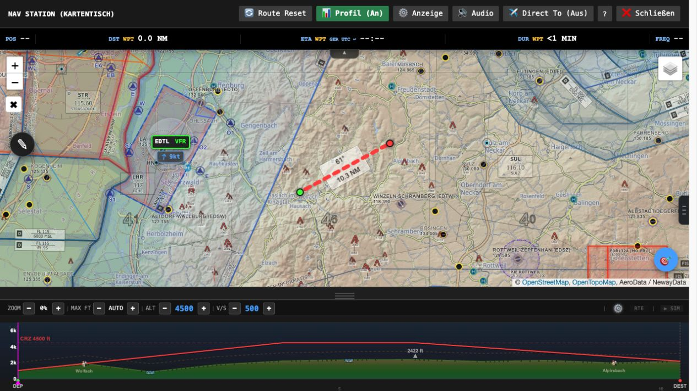
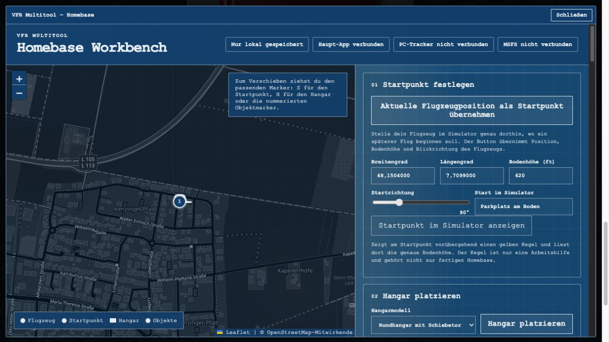

# VFR Multitool

Das VFR Multitool begleitet deine VFR-Flüge im Microsoft Flight Simulator: von der Flugidee über Planung und Missionen bis zur Live-Karte im Cockpit. Diese Anleitung erklärt die größeren Funktionen und ihre Bedienung.

**Stand: 27. Oktober 2026 · Origin / Alpha.** Diese Anleitung beschreibt den Origin-Stand. Stable kann einen anderen Funktionsumfang haben. Versionshinweise in App und Tracker sind maßgeblich.

[Multitool öffnen](index.html) · [Willkommen](willkommen.html) · [Geführte Einrichtung](onboarding.html)

Das Tool ist für den Flugsimulator gedacht. Karten, Wetter und Warnungen sind keine Grundlage für reale Flüge.

## 1. Schnellstart und Orientierung

Du kannst das Multitool auf drei Arten nutzen:

- **Planen:** Start, Ziel und Flugzeug wählen, Briefing ansehen, Route bearbeiten und exportieren. Das geht bereits im Browser.
- **Frei fliegen:** Im Kartentisch mit **Direct To** ein eigenes Ziel setzen. Mit Tracker folgt die Karte deinem Flugzeug; eine Mission ist dafür nicht nötig.
- **Eine Mission fliegen:** Auftrag erzeugen, prüfen und akzeptieren. Für den tatsächlichen Missionsablauf im Simulator brauchst du den verbundenen Windows-Tracker.

### Dein erster Auftrag

1. Unter **Start / DEP** deinen Startplatz eingeben, etwa `EDTW`, und den passenden Suchtreffer auswählen.
2. Ein Flugzeug-Preset wählen oder Geschwindigkeit, Verbrauch, Reiseflughöhe und Steig-/Sinkrate einstellen.
3. Missionstyp, Distanz und Richtung wählen. Ein leeres Ziel lässt den Dispatcher suchen.
4. **Auftrag generieren / DISPATCH** anklicken. Das Briefing prüfen und **Mission akzeptieren** wählen.
5. Tracker und MSFS verbinden. Mit installiertem EFB-Paket kannst du schon auf der **Weltkarte** das VFR Multitool im EFB öffnen und den vorbereiteten Flug an die Simulator-Flugplanung senden. Die Übernahme prüfen und den Flug im Simulator laden.
6. Im geladenen Cockpit am Boden stehen und im Kartentisch **Mission starten** wählen.
7. Die angezeigten Schritte für Boarding, Verladung und Auftrag abarbeiten.

Für die komplette Ersteinrichtung nutze die [Onboarding-Seite](onboarding.html). Diese Anleitung dient danach zum Nachschlagen.

### Wo finde ich was?

- **Hauptseite:** Dispatch, Flugzeug-Presets, Briefing, Flugbuch, Homebase und Einstellungen.
- **Kartentisch:** Route, Live-Position, Höhenprofil, Anzeige- und Audio-Menü sowie Werkzeuge.
- **Seitenmenü im Kartentisch:** Checklisten, Mission, Wetter, Radio, Warnungen, Platzinformationen, Nearest und Ladung.
- **Windows-Tracker:** Verbindung, Audioausgabe, Autostart, Updates und Zusatzpakete.
- **MSFS-2024-EFB und Toolbar:** Cockpit-Zugriff auf Karte, Mission und Werkzeuge über den laufenden Tracker.

## 2. Pilot-ID, Cloud und KI einrichten

### Pilot-ID und Cloud-Sync

**Hier:** Hauptseite → **Einstellungen** → **Pilot Identity & Sync**.

Die Pilot-ID ist dein gemeinsames Profil. Eine **PIN aus 4 bis 8 Ziffern** schützt den Zugriff.

1. Eine eigene, eindeutige Pilot-ID und eine PIN eintragen.
2. **Login** anklicken. Eine noch freie ID wird dabei registriert; für eine vorhandene ID brauchst du deren PIN.
3. **Auto-Sync** aktivieren, wenn gespeicherte Inhalte automatisch abgeglichen werden sollen.
4. Auf Tablet, Zweitgerät und im Tracker dieselbe ID und PIN verwenden.

**Push** schreibt den aktuellen Stand in die Cloud. **Pull** holt den Cloud-Stand auf das Gerät. Bei unterschiedlichen Ständen zuerst prüfen, welches Gerät die gewünschten Daten enthält.

Neu erstellte Entwürfe und akzeptierte Aufträge werden bei aktivem Auto-Sync geräteübergreifend gespeichert. Ein noch nicht bestätigter Upload bleibt vorgemerkt und wird erneut versucht. Ein wieder geladenes Briefing ist dabei nicht automatisch eine gestartete Mission.

### KI für Briefings

**Hier:** Einstellungen → **KI-Dispatcher**.

Die optionale KI ergänzt Aufträge um individuelle Briefings, Passagiere, Fracht und Hintergründe. Ohne KI bleiben Kartenplanung und lokal erzeugte Aufträge verfügbar.

- **Provider:** Gemini oder ChatGPT (OpenAI). Der Schlüssel muss zum gewählten Anbieter gehören.
- **API-Key:** im angezeigten Feld für Gemini beziehungsweise OpenAI eintragen und die Statusmeldung prüfen.
- **KI an/aus:** bestimmt, ob die KI genutzt wird.
- **Profil:** Auto, Sparsam, Qualität oder High Quality. Für den Einstieg eignet sich Auto; Sparsam ist für häufiges Ausprobieren gedacht.

Gemini-Schlüssel erstellst du in [Google AI Studio](https://aistudio.google.com/apikey), OpenAI-Schlüssel auf der [OpenAI-Plattform](https://platform.openai.com/api-keys). Offizielle Hilfen: [Gemini API-Keys](https://ai.google.dev/gemini-api/docs/api-key) und [OpenAI API-Einstieg](https://developers.openai.com/api/docs/quickstart).

Die Anbieter regeln Kontingente und Abrechnung. KI-Briefings und KI-Stimmen können getrennten Verbrauch verursachen. Prüfe die Nutzung beim Anbieter; ein Chat-Login allein ersetzt keinen API-Key.

### Warum Schlüssel und Anmeldung im Tracker erneut eintragen?

Die **Pilot-ID + PIN** ordnen die Verbindung deinem Piloten zu. Der **Web-API-Key** ermöglicht KI-Briefings im jeweiligen Browser. Der **Voice-Key im Tracker** ermöglicht die zentrale KI-Sprachausgabe, auch für EFB und Toolbar.

Browser und Tracker speichern diese Zugänge getrennt. Der Web-Key wird nicht über dein Pilotenprofil synchronisiert. Auf einem weiteren Web-Gerät trägst du ihn erneut ein. Der Startdialog bietet an, ihn für weitere Besuche auf diesem Gerät zu merken; lokaler Website-Speicher ist nicht verschlüsselt. Der Tracker schützt seinen gespeicherten Voice-Key mit deinem Windows-Konto.

Teile PIN und API-Keys nicht über Pinnwände oder Screenshots. Die für KI-Anfragen benötigten Inhalte werden an deinen ausgewählten Anbieter gesendet.

## 3. Flugzeug, Darstellung und Flugplatzsuche

### Flugzeug-Presets

Du kannst bis zu 10 Flugzeug-Presets anlegen. Die drei Preset-Buttons auf der Hauptseite und im NavCom sind Schnellwahl-Plätze (anfangs C172, Comanche und Aerostar). Ein Klick wählt das Preset auf dem Button; Rechtsklick oder Langdruck öffnet eine Liste, aus der du dem Button ein anderes Preset zuweist. Presets anlegen, bearbeiten und löschen kannst du unter **Einstellungen → Aircraft / Presets**: **+** legt ein neues an, ein Klick auf ein Preset öffnet den Editor.

- **TAS:** geplante Reisegeschwindigkeit in Knoten; beeinflusst Flugzeit und Planung.
- **GPH:** geplanter Verbrauch in US-Gallonen pro Stunde; Grundlage der Fuel-Schätzung.
- **Cruise ALT:** gewünschte Reiseflughöhe für Route, Profil und Hinweise.
- **V/S:** geplante Steig-/Sinkrate für Steig- und Sinkflugprofil.
- **Sitze, Zuladung und Flugzeugklasse:** helfen dem Dispatcher, passende Aufträge und Beladungen auszuwählen.
- **Einsatzprofile:** etwa Privat/Reise, Charter, Cargo, Utility, Bush/STOL oder Training. Sie begrenzen die automatische Zufallsrotation; eine gezielte Mission bleibt auswählbar.

Bei unpassenden Zeiten oder Frachtmengen zuerst die Flugzeugwerte prüfen. Boarding-Tür und relative Wegpunkte lassen sich pro Preset anpassen, wenn die Szene im Simulator nicht zum Flugzeug passt.

### Oberflächen und Größen

Unter **Einstellungen → Darstellung** stehen Modern, Analog, NavCom, Ops 1940 und Win95 zur Wahl. Sie bedienen dieselben grundlegenden Daten.

- **Analog:** mechanisch wirkendes Panel. Die Schraube oben rechts wechselt das Design (Klassik, Tower, Fernschreiber), die Schraube oben links die Lackierung.
- **NavCom:** Radio-Stack mit Drehknöpfen sowie DATA- und DISPATCH-Bedienung. Die Schraube oben rechts wechselt das Design (Klassik, Bendix, KX); die Anzeigefarbe änderst du über O/M/I, die TEST-Taste oder im KX über PULL TEST.
- **Ops 1940:** instrumentenartige Missionsauswahl und Briefing-Darstellung.
- **Win95:** Fenster- und Desktop-Gestaltung im klassischen PC-Stil.

In Analog und NavCom bildet das **Glareshield** die Panel-Oberkante: seitlich wischen wechselt das Material, außen hoch- oder runterziehen biegt es, in der Mitte nach unten ziehen öffnet eine Design-Liste.

Passe mit **Seitengröße** die Bedienung an Tablet, Monitor oder VR an. Uhren- und Medien-Skins sind davon unabhängig wählbar. Auf iPad/iPhone kannst du die Web-App über Safari zum Home-Bildschirm hinzufügen.

### Flugplätze suchen und merken

Start und Ziel lassen sich über Kennung, Namen und Suchvorschläge auswählen. Der selbst gehostete Bestand enthält weltweite Flugplätze, auch ohne klassischen ICAO-Code. Prüfe bei ähnlichen Namen den angezeigten Ort und wähle den Treffer bewusst aus.

Mit dem **Stern** in der Flugplatzsuche merkst du dir Favoriten. Sie erscheinen beim Öffnen eines passenden Felds und werden in den Ergebnissen bevorzugt angeboten. Auch auf der Karte gibt es Favoriten-Sterne; die Anzeige lässt sich unter **Anzeige → Favoriten** schalten.

Der Filter **Platztypen** begrenzt die angebotenen und automatisch gewählten Plätze. Für zivile Heliports muss **Heli** ausdrücklich aktiviert sein. Unterschiedliche Start-/Zieltypen lassen sich durch mehrere ausgewählte Kategorien kombinieren.

## 4. Dispatch und Missionsarten

### Zufall, Vorschläge oder eigenes Ziel

- **Ziel leer / RNDM / ----:** der Dispatcher sucht ein Ziel.
- **Ziel vorgeben:** eine bestimmte Verbindung planen, soweit sie zum gewählten Profil passt.
- **RDM:** direkt zufällig erzeugen.
- **PICK:** zunächst Vorschläge sehen und einen davon ausarbeiten lassen.
- **Distanz und Richtung:** grenzen den Suchraum ein. Zu enge Vorgaben können die Auswahl stark beschränken.
- **Region:** soweit in der gewählten Ansicht angeboten, zwischen regionalen beziehungsweise internationalen Zielen eingrenzen.

Die Flugzeugwerte und das gewählte Einsatzprofil beeinflussen die Auswahl. Ein Entwurf lässt sich prüfen, bevor du ihn akzeptierst.

### Flugplatz-, POI- und Bush-Aufträge

**APT** führt in der Regel von einem Flugplatz zum anderen: Verein, Privat, Charter, Cargo, Training, Medizin-Transfer, fragile Fracht, Tiertransport, Reporter oder Sightseeing.

**POI** stellt eine Aufgabe an einem Ort in den Mittelpunkt: Training, Infrastruktur-Inspektion, Ketten-Erstbefund, Foto/Film, Mapping/Survey, Reporter, Sightseeing, Lern-Guide, Historiker, Bio/Umwelt, Geo/Relief, SAR/Rescue oder Fire Watch.

**Bush** steht für abgelegene Landeplätze und Backcountry-Flüge: Versorgung, Charter, Adventure, Erkundung mit Rückkehr sowie Passagier- oder Frachtabholung mit Rückflug.

Zusätzlich kannst du nach Zielkategorien wie Brücken, Straßen, Staudämmen, Funkmasten, Industrie, Burgen, Gewässern, Bergen oder Städten suchen. **Freiflug/Planung** liefert eine Planungsroute ohne Missionsablauf.

### Was verlangt ein Auftrag?

Lies das konkrete Briefing: Eine Fotoaufgabe ist etwas anderes als eine Sichtprüfung, eine Flächenvermessung oder eine Abholung. Nicht jeder POI-Flug verlangt ein Foto, nicht jeder Auftrag endet am ersten Ziel und nicht jede Mission nimmt Passagiere mit.

Bei Training, Mapping und anderen Arbeitsaufträgen können bestimmte Höhen, Bereiche, Zeiten oder einzelne Bestätigungen nötig sein. Die aktuellen Bedingungen findest du während des Flugs in **Mission Control**.

## 5. Briefing und Flugplan-Übergabe

### Was steht im Briefing?

- **Auftrag:** Titel, Hintergrund, Passagiere, Fracht, Strecke, Kurs und geschätzte Flugzeit.
- **Nav-Log:** Wegpunkte, Frequenzen, Kurse, Entfernungen, Zeiten und Fuel-Schätzung.
- **Start und Ziel:** verfügbare Pisten-, Wetter-, Frequenz-, AIP- und Ortsinformationen.
- **Höhenprofil:** Gelände, Höhenplanung und verfügbare Hinweise entlang der Route.

Im Nav-Log kann der Luftraumfilter die Warnungen auf deine geplante Flughöhe begrenzen. Ein Quellenlink hilft, ergänzende Flugplatz- oder Wetterinformationen zu öffnen.

### Flugcode, PDF und MSFS-Datei

Über **DATA / 💾 / Transfer** kannst du Flugcodes kopieren oder laden und MSFS-Flugpläne importieren beziehungsweise als `.pln` exportieren. Die PDF-Funktion erzeugt ein Briefing zum Mitnehmen oder Drucken.

Akzeptiere einen Missionsentwurf, bevor du ihn als Auftrag pinnst, teilst oder für den Flug weitergibst. Ein reiner Planungsimport ist noch kein gestarteter Auftrag.

### Schon auf der Weltkarte über das EFB laden

Du kannst den vorbereiteten Flug bereits auf der **Weltkarte von MSFS 2024** übernehmen:

1. Den Auftrag im Multitool vorbereiten und **Mission akzeptieren** wählen.
2. Den Tracker laufen lassen und auf der Weltkarte das **VFR Multitool im EFB** öffnen. Dafür muss das EFB-Paket installiert sein.
3. Im Planungshinweis **Flugplan an Flugsicherung senden** wählen. Die Bestätigung abwarten und Startposition sowie Flugzeug im Simulator prüfen.
4. Den Flug im Simulator laden. Sobald du im Cockpit am Boden bereit bist, **Mission starten** wählen.

So bringst du die Planung schon vor dem Einstieg ins Cockpit in den Simulator. Die Weltkarten-Übertragung allein startet noch keine Mission und lädt keine Passagiere oder Fracht.

### Direkt an MSFS und Avionik senden

Mit passendem Tracker und Cockpit-Paket kannst du die Route auch aus dem EFB beziehungsweise der Toolbar an die **Simulator-Flugplanung** senden. Die Planungshinweise bieten den passenden Übertragungsweg an. Ein geschlossenes Planungsbanner lässt sich über die Toolbar wieder aufrufen.

In Mission Control gibt es die Übertragung an **MSFS** sowie an **MSFS und Avionik**. Für die Avionik vorher das Gerät einschalten und hochfahren lassen. Nicht jedes Flugzeug übernimmt einen Plan gleich; die Bestätigung ansehen und die Route im Gerät kontrollieren.

Fehlt die Bestätigung der Übernahme, nicht von einer erfolgreichen Übertragung ausgehen.

## 6. Mission, Passagiere und Verladung

### Starten und den nächsten Schritt finden

Nach **Mission akzeptieren** ist der Auftrag vorbereitet. Im normalen Simulatorbetrieb steuert der **Tracker** den Missionsablauf; Web-App, EFB und Toolbar zeigen denselben Stand und die dort erlaubten Aktionen.

1. Tracker verbinden und das Cockpit vollständig laden.
2. Am Boden anhalten und **Mission starten** wählen.
3. Boarding und Verladung nach den angezeigten Vorgaben durchführen.
4. Erst nach Freigabe zum eigentlichen Flug aufbrechen.

**Mission Control** im Kartentisch-Seitenmenü zeigt Aufgabe, Phase, Entfernung, Arbeitshöhe, Arbeitszeit oder Flächen-/Kettenfortschritt. Dazu kommen Pflichtbedingungen, Passagierstimmung, Ladungszustand und Abweichungshinweise.

### Verlade-Manager

Der Verlade-Manager bündelt **Laden**, **Abholen** und **Entladen**. Er zeigt die für die aktuelle Station relevanten Personen und Gegenstände sowie den Bordbestand.

1. Pflichtpositionen laden, abholen oder am richtigen Ziel entladen.
2. Die Liste **unterschreiben** und die Unterschrift abwarten.
3. Danach die Verladung **separat bestätigen**.

Eine Änderung nach der Unterschrift macht eine neue Unterschrift nötig. Eine Start-Unterschrift gilt nicht automatisch für Abholung oder Ankunft. Das Schließen des Fensters verwirft den bearbeiteten Zustand nicht. Den Dialog kannst du über den Ladungsbereich wieder öffnen.

Im Simulator-Menü und auf der Weltkarte ist die Verladung gesperrt. Wenn ein Auftrag nicht weitergeht, prüfe Pflichtpositionen, Unterschrift und Bestätigung sowie die nächste erwartete Aktion.

### Boarding, Gepäck und Ankunft

Je nach Auftrag erscheinen Personen, Gepäck, Fracht und passende Szenen im Simulator. Boarding und Ausstieg gehören zum Ablauf; ein offener Zielpunkt allein erledigt noch keine Abholung.

Bei Abholaufträgen kann nach der Beladung ein Rückflug anstehen. Bei Ankunft müssen die vorgesehenen Gegenstände und Personen übergeben werden, bevor Abschluss und Debrief freigegeben sind. Warte auf noch laufende Ein-/Ausstiegsaktionen oder Abschiedsansagen.

Passagiertexte und optionale Stimmen begleiten Missionsphase und Flugverhalten. Verfügbare Gesprächs- und Aufgabenaktionen erscheinen in den Missions-/Passagierbereichen. Neue Einträge können durch einen Hinweis markiert sein; du musst nicht ständig alle Bereiche offen halten.

### Bordbestand und Bordbuch

Bordbuch, Verbandzeug, Feuerlöscher und Radkeile lassen sich am Boden im Stillstand verwalten, auch unabhängig von einer Mission. Sie sind vom verpflichtenden Missionsgepäck getrennt. Zurückgelassene Gegenstände können nach dem Abflug als verloren gelten.

Das **Bordbuch** gehört zur mitgeführten Ausstattung. Das rote **Flugbuch auf der Hauptseite** zeigt dagegen abgeschlossene Flüge und deren Auswertung.

## 7. Unterbrechen, Fortsetzen und Flugbuch

### Einen laufenden Auftrag wieder aufnehmen

Bei einer Simulator-Trennung oder einem Tracker-Neustart kann der laufende Missionsstand erhalten bleiben. Die Oberfläche zeigt einen gespeicherten oder unterbrochenen Auftrag; Boarding- und Verladeaktionen warten währenddessen.

Starte MSFS wieder und lade einen Flug. Im aktuellen Ablauf ist Fortsetzen der Normalfall: Das geladene Cockpit nimmt die Mission wieder auf, sobald die Bedingungen am Speicherpunkt erfüllt sind. Kurze Verbindungsunterbrechungen können sich selbst erholen.

- **Unterbrechung am Boden:** das Flugzeug am angezeigten Start-, Ziel- oder Speicherpunkt abstellen und kurz stabil stehen lassen.
- **Unterbrechung in der Luft:** zur markierten Zone fliegen und die angezeigte Zeit normal weiterfliegen. Wenn angeboten, kannst du dich an den Speicherpunkt versetzen lassen.

### Gespeicherten Flug über die Weltkarte fortsetzen

Auch einen gespeicherten, unterbrochenen Flug kannst du schon auf der **Weltkarte** wieder vorbereiten:

1. Den Tracker starten und in MSFS 2024 auf der Weltkarte das **VFR Multitool im EFB** öffnen.
2. Beim unterbrochenen Auftrag **Speicherstand laden** wählen, sobald die Aktion angeboten wird. Damit wird der Wiedereinstieg an die Simulator-Flugplanung übergeben; bei einer Unterbrechung in der Luft kann dies ein Luftstart am Speicherpunkt sein.
3. Die Bestätigung und Hinweise beachten, das passende Flugzeug wählen und den Flug im Simulator laden.
4. Im Cockpit den Wiederaufnahme-Hinweisen folgen. Sobald die Bedingungen am Speicherpunkt erfüllt sind, läuft dein bisheriger Auftrag weiter. Den Flugplan bei Bedarf anschließend über **Flugplan laden** in die Avionik übernehmen.

Du musst dafür keinen neuen Auftrag erzeugen oder die Mission zurücksetzen.

Eine für den Wiedereinstieg gesendete Weltkarten-Position und die Route für die Avionik erfüllen unterschiedliche Aufgaben. Kontrolliere Startposition und anschließend den Flugplan im Cockpit. Ein Speicherstand lädt nicht selbstständig ein bestimmtes Flugzeugmodell.

### Wiederaufnahme oder Neustart?

**Wieder aufnehmen** soll deinen laufenden Auftrag erhalten. **Mission neu starten / zurücksetzen** beginnt den Ablauf erneut; **abbrechen** beendet den Auftrag. Wähle Reset nicht nur deshalb, weil der Tracker vorübergehend fehlt.

Bereits geplante und akzeptierte Aufträge ohne Missionsstart haben keine Altersgrenze. Die Browser-Wiederherstellung eines begonnenen Auftrags und der gespeicherte Tracker-Lauf sind unterschiedliche Sicherungen; folge dem aktuell angezeigten Tracker-Status. Eine Browser-Zeitgrenze ist kein allgemeines Ablaufdatum für jeden Tracker-Speicherstand.

### Abschluss und Debrief

Nach erfülltem Auftrag und abgeschlossener Übergabe wird **Abschluss & Debrief** beziehungsweise **Mission beenden** verfügbar. Die Auswertung zeigt die aufgezeichneten Flugdaten; bei mehrteiligen Flügen werden die vorhandenen Abschnitte für die Missionsauswertung zusammengeführt.

Der finale Missionsabschluss schreibt den Eintrag automatisch ins Flugbuch. Ein Zwischenhalt ist noch nicht der endgültige Missionsabschluss.

### Das rote Flugbuch

Auf der Hauptseite das rote Leder-Flugbuch öffnen. Es zeigt Datum, Flugzeug, Strecke, Dauer, Entfernung und eine Auftragsnotiz. Mit den Seitentasten blätterst du; ein vorhandener Eintrag öffnet seine Details beziehungsweise das Debrief.

Das Leeren des gesamten Flugbuchs ist eine eigene Aktion mit Bestätigung. Reine Direct-To-Flüge besitzen keinen Missionsabschluss und sind deshalb nicht automatisch dasselbe wie ein protokollierter Missionsflug.

## 8. Kartentisch, Route und Funk

### Die Karte im Alltag

Der **Kartentisch** funktioniert mit Auftrag, importierter Route und Freiflug. Über das Vollbild-Symbol bekommt die Karte mehr Platz. Auf kleinen Displays kannst du die obere Werkzeugleiste einklappen.

- Wegpunkte verschieben, ergänzen und entfernen; **Route Reset** setzt manuelle Anpassungen zurück.
- **Snapping** hilft beim Einrasten an Flugplätzen, Funkfeuern und Meldepunkten.
- **Auto-Follow** folgt deiner Live-Position; **Autozoom** passt den Ausschnitt mit Vorausschau an.
- Route-Leiste, Telemetrie, aktuelle Position und Wegpunkt-Info lassen sich unter **Anzeige** einblenden.
- Kartenstile und Layer wählst du im Kartenmenü. Verfügbarkeit und Darstellung unterscheiden sich zwischen Browser und Cockpit.

Im Browser gibt es zusätzlich die reduzierten OpenFreeMap-Stile **Positron (Hell)**, **Dark** und **Fiord**. Sie benötigen WebGL und Internet. EFB und Toolbar nutzen ihre unterstützten Raster-Basiskarten; eine Browser-Kartenwahl bedeutet dort nicht automatisch denselben Kartenstil.

### Direct To ohne Auftrag

1. Kartentisch öffnen und **Direct To** einschalten.
2. Einen Flugplatz oder Kartenpunkt als Ziel wählen.
3. Bei Live-GPS beginnt die Verbindung an deiner aktuellen Position; sonst wird ein vorhandener Planungsstart verwendet.

Dafür sind kein Boarding, keine Fracht und kein Missionsstart nötig. Für Story, Aufgaben, Abholungen und Missionsszenen wählst du einen echten Dispatch.

### Radio und Frequenzen übernehmen

Der Radio-Bereich bietet verfügbare Frequenzen zu Route und Flugplätzen; die Wegpunkt-Info unterstützt die Orientierung zum nächsten Abschnitt. Auch ATIS kann angezeigt werden, wenn die Daten vorhanden sind.

Unter **Anzeige → NAVCOM** legst du fest, wie angebotene Frequenzen bedient werden:

- **AUS:** keine direkte Funkübernahme.
- **Gerät 1 aktiv:** direkte Übernahme auf das erste passende Gerät.
- **Auswahl:** Zielgerät und, soweit verfügbar, Aktiv oder Standby bewusst auswählen.

Mit passendem Tracker lassen sich unterstützte COM-, NAV-, ADF- und Transponderwerte an den Simulator übertragen. Prüfe die Rückmeldung und das tatsächliche Gerät; nicht jede individuelle Flugzeug-Avionik unterstützt alle Standardfunktionen.

Die NAVCOM-Bedienungsart wird mit deinem Profil abgeglichen. Ein Wechsel der Bedienungsart stellt allein noch keine Frequenz um.

### Nearest und Platzinformationen

**Nearest** sucht mit Live-Position nahe Flugplätze. **Platz** bündelt verfügbare Start-/Zielinfos und AIP-Links. Auf der Karte kannst du Flugplätze und Punkte für weitere Informationen auswählen. Fehlende Daten sind keine Bestätigung, dass es vor Ort keine Frequenz, Einschränkung oder Besonderheit gibt.

## 9. Wetter, Lufträume und Gelände

### Wetter und VFR-Index

Unter **Anzeige** kannst du Wetterlayer mit verfügbaren METAR-/Modellinformationen, Wind und Wolken aktivieren. Das Wetter-Seitenmenü ergänzt die Angaben entlang deiner Route.

Der **VFR-Index** bietet eine regionale Übersicht mit Planungsland, Modellauswahl und Zeitfenster. Du kannst zwischen den angebotenen Modellansichten wechseln, das Ampelfenster wählen und die Daten aktualisieren.

Achte auf Quelle, Zeitpunkt und verfügbaren Bereich. Ein Wettermodell und ein Flugplatz-METAR beantworten nicht dieselbe Frage. Die Kartenanzeige ist kein Beleg dafür, dass MSFS gerade genau dieses Wetter simuliert.

### Höhenprofil

Das Profil zeigt den Flug von der Seite: Gelände, verfügbare Hindernisse, Luftraumgrenzen, Wetter und gegebenenfalls Verkehr. Reiseflughöhe und Steig-/Sinkrate beeinflussen den geplanten Höhenverlauf und TOC/TOD.

Du kannst horizontal zoomen, die Höhenachse automatisch oder manuell skalieren und die Profilhöhe am Griff ändern. **RTE** folgt der geplanten Route; **HDG** blickt bei verfügbaren Live-Daten in die aktuelle Flugrichtung.

### Terrain Avoid und Warnungen

**Terrain Avoid** färbt Gelände nach deiner Live-Höhe beziehungsweise der verwendeten Planungshöhe. Warn- und Freiraumschwellen lassen sich einstellen. Prüfe eine sinnvolle Höhe, bevor du die Darstellung bewertest.

Luftraum-, Terrain-, Frequenz- und Wegpunkthinweise kannst du getrennt aktivieren. Das Warnungen-Seitenmenü hilft bei den aktuellen Luftrauminformationen. Verkehr stammt aus den verfügbaren Simulator-Daten und ist kein vollständiges Bild jedes Online-Netzwerks.

## 10. Checklisten, Rechner und Uhren

### Checklisten

**Hier:** Kartentisch → Seitenmenü → **Checklist**.

Es gibt eingebaute Listen, eigene Checklisten und Community-Listen. Du kannst eigene Kapitel und Punkte anlegen, umsortieren und Listen per Code importieren oder weitergeben. Community-Listen lassen sich abonnieren beziehungsweise als Grundlage kopieren; eigene Veröffentlichungen werden gesondert verwaltet.

Listenbibliothek und Häkchen sind zu unterscheiden: Die Bibliothek kann auch dem passenden Tracker/EFB bereitgestellt werden; der aktuelle Abhakfortschritt gehört zur jeweiligen Bedienansicht. Verlass dich nicht darauf, dass jedes bereits abgehakte Kästchen sofort auf allen Geräten identisch erscheint.

### Zeichnen, Messen, VFR-Rechner und E6B

Über die Kartenwerkzeuge erreichst du Stift, Radierer, Farben, Strichstärke und das Messwerkzeug. Zeichnungen sind für Hinweise und Skizzen gedacht; sie ändern nicht automatisch die Flugroute.

Der **VFR-Rechner** hilft unter anderem bei Zeit, Fuel, Wind, Sinkflug und Einheiten. Die Formelhilfe erklärt die verwendeten Zusammenhänge. Der **E6B** ergänzt den klassischen interaktiven Flugrechner mit Rechen- und Windseite.

### Zeit, Timer und Watch

Unter **Anzeige → Zeit** wählst du Uhransicht, Zeitquelle **Simulator / Gerät** und **UTC / Lokal**. Fehlen brauchbare Simulator-Zeitdaten, zeigt die Oberfläche den Geräte-Fallback an.

Über das Uhr-Werkzeug öffnest du Stoppuhr beziehungsweise **A Watch**. Timer und Zeitmessung lassen sich unabhängig vom Hauptdesign nutzen. Die Uhrenwahl ist nicht an den eingestellten Medien-Skin gekoppelt.

**Low FPS Mode** und angepasste Seitengröße können auf schwächeren Tablets oder in VR helfen. Zu viele gleichzeitig sichtbare Layer und Fenster kosten Übersicht und Leistung.

## 11. Stimmen, Musik und Funk-Pause

### Warnungen und Passagierstimmen

**Hier:** Kartentisch → **Audio**; am PC zusätzlich Tracker → **Audio**.

Warnungen, Frequenz- und Wegpunktansagen sowie Passagier-/Story-Stimmen können getrennt eingestellt werden. Texte bleiben nutzbar, wenn Stimmen ausgeschaltet sind. Stimme, Klang und angebotene KI-Optionen wählst du nach Bedarf.

Für die zentrale Spracherzeugung im Tracker unter **Provider / API-Key** einen passenden Gemini- oder OpenAI-Key eintragen und **Sicher speichern** wählen. Ein laufender Tracker wird dabei neu gestartet: Änderungen vor dem Flug durchführen.

### PC-Ausgang und Musiksteuerung

Im Tracker **Audio aktiviert**, **PC-Ausgang** und Lautstärke prüfen. Wähle etwa dein Headset statt versehentlich eines anderen Windows-Ausgangs.

Öffne deinen Musikplayer auf Windows und starte die Wiedergabe dort. Unter **Musik / Windows-Player** beziehungsweise in der Multitool-Mediensteuerung wählst du die verfügbare Quelle. Die Funktionen nutzen den laufenden Windows-Player und dessen unterstützte Steuerung; das Multitool stellt kein Musikabo und keine eigene Streaming-Bibliothek bereit.

Im Kartentisch-Audio-Menü die **Mediensteuerung** einschalten. Als Skin stehen **Winamp**, **iPod** und **Watch** bereit. Damit steuerst du Wiedergabe und verfügbare Titel-/Zeitinformationen. Player und Uhren besitzen eigene Größen- und Ansichtsoptionen.

**Bei Ansagen leiser** senkt die Musik während Stimmen und Warnungen ab. Mit der Restlautstärke bestimmst du, wie viel davon hörbar bleibt. Diese Einstellung wird mit der Windows-Ausgabe abgestimmt.

### Funk-Pause per Taste oder Joystick

**Hier:** Tracker → Audio → **Funk-Pause (PTT)**.

1. **Funk-Pause aktiv** einschalten.
2. Über **+ Button hinzufügen** eine Taste oder einen Joystick-Button anlernen. Mehrere Belegungen sind möglich.
3. Für Stimmen/Warnungen **Pausieren** oder **Leiser** wählen; für Musik stehen ebenfalls passende Optionen bereit.
4. Unter **Automatisch weiter nach** die Wartezeit nach dem Loslassen einstellen. So bleibt Raum für die Funkantwort.

Der Knopf bleibt für dein Funkprogramm und den Simulator verwendbar. Ein kurzer Druck kann während einer bestehenden Pause die Ausgabe sofort fortsetzen, wenn die entsprechende Option aktiv ist. Die Funk-Pause betrifft die PC-Ausgabe.

### Sprechende Programme automatisch erkennen

**Programme automatisch erkennen** aktivieren und über **+ Programm hinzufügen** das gewünschte Programm auswählen, während es Ton ausgibt. Zum Beispiel kann dein Funkprogramm die Stimmen pausieren lassen.

Pro Programm kannst du Reaktion, Empfindlichkeit und **Auslösen nach** festlegen. **Wie PTT** nutzt die gemeinsamen Pausenregeln; **Nur leiser** senkt die Ausgaben ab. Die Erkennung liest Audiopegel und zeichnet keine Gespräche auf.

## 12. Tracker, Autostart und Updates

### Installieren und verbinden

Den Windows-Tracker über den Download in **Einstellungen → Pilot Identity & Sync** installieren. Das Programm lädt seine passende Tracker-Version und prüft Updates.

Unter **Konto** dieselbe Pilot-ID und PIN wie in der Web-App eintragen, dann **Prüfen & verbinden** wählen. Der Tracker prüft ein vorhandenes Profil; eine neue ID legst du zuerst in der Web-App über Login an.

Der Tracker und die Web-App müssen zum selben Piloten angemeldet sein. Eine Desktop-App-Version, eine Tracker-Version und eine EFB-Paketversion sind unterschiedliche Bestandteile; sie müssen nicht dieselbe Versionsnummer tragen.

### Was bedeuten die Statusanzeigen?

- **WAIT / Wartet:** die App oder ein Verbindungsteil wartet noch; das allein bestätigt keinen aktiven Simulator.
- **LINK:** Tracker verbunden, aber keine frischen Live-Flugdaten.
- **LIVE:** aktuelle Sim-Daten treffen ein.
- **HIB:** der Tracker ruht etwa bei Pause, im Menü oder in einem passenden Stillstand; bei aktivem Flug kann er wieder aufwachen.
- **OFF:** keine aktive Tracker-Telemetrie.

**C** und **R** kennzeichnen die verfügbaren Verbindungswege. Entscheidend für den Flugtest sind verbundener Simulator und frische Live-Daten, nicht allein ein grüner Verbindungspunkt.

### Tracker automatisch starten oder ins Tray legen

Im Modul **Tracker** legst du fest, ob die Tracker-Engine beim Öffnen der Desktop-App automatisch startet und ob das Fenster künftig minimiert im Windows-Tray beginnen soll. Bei nötiger Anmeldung oder einer Updateentscheidung kann sich das Fenster trotzdem zeigen.

Das ist von der folgenden Programm-Startliste und vom Windows-Start beim Hochfahren zu unterscheiden.

### Autostart für deinen Flugabend

**Hier:** Tracker → **Autostart**.

1. **Autostart aktivieren** einschalten; oben erscheint **Tracker & Sim starten**.
2. Mit **Sim erkennen** installierte MSFS-Versionen finden und gegebenenfalls auswählen.
3. Programme oder Verknüpfungen in die Liste ziehen oder **Importieren** wählen.
4. Reihenfolge durch Ziehen oder Pfeile ändern und über **Danach warten** Pausen festlegen.
5. Helfer, die einen laufenden Simulator brauchen, unter **Auf SimConnect warten** einordnen.

Der Tracker ist ein fester Eintrag in der Startliste. Der gemeinsame Startknopf führt die Liste aus; bereits laufende Programme werden übersprungen. Über die Zusatzoptionen sind unter anderem minimierter Start, Argumente und gegebenenfalls Administratorstart möglich.

**Mit dem Sim schließen** berücksichtigt nur Programme, die dieser Autostart selbst geöffnet hat. Der Simulator selbst wird damit nicht geschlossen. Das Modul richtet nicht automatisch den Windows-Autostart beim Hochfahren ein.

### Updates, Stable und Alpha

Desktop-App, Tracker-Engine, Homebase-Paket, EFB und Bridge haben eigene Updatebereiche beziehungsweise Regeln. Neue Versionen können einmalig installiert, künftig automatisch übernommen oder auf später verschoben werden, soweit angeboten.

**Stable** ist für den regulären Betrieb voreingestellt. **Alpha** enthält neuere Teststände. Ein Kanalwechsel kann den laufenden Tracker neu starten und ein anderes EFB-Paket erfordern. Plane solche Änderungen vor einem Flug und prüfe den angezeigten Kanal.

### Optionale AccuSim Telemetry Bridge

Für passende DRSM-/Motion-Nutzung kann das Modul **AccuSim Telemetry Bridge** eine vorhandene Installation erkennen oder einen Installer anbieten. Einstellungen und Start-/Stopp-Verhalten sind über den Tracker erreichbar. Für normale Kartenplanung, Missionen oder einen ersten Live-Test ist die Bridge nicht erforderlich.

## 13. MSFS-2024-EFB, Toolbar und VR

### Cockpit-Paket installieren

Im Tracker das Modul **VFR Multitool EFB** öffnen und dem angebotenen Installationsweg folgen. MSFS für Paketänderungen schließen und danach neu starten. Das aktuelle gemeinsame Paket enthält EFB-App und Toolbar-Panel; der Tracker muss laufen, damit der volle Kartentisch verfügbar ist.

Wenn eine ältere Version nur eine reduzierte Karte zeigt oder die Verbindung fehlt, zuerst Tracker, Kanal und EFB-Paket prüfen. Eine sichtbare Basiskarte allein bestätigt noch nicht, dass alle Missionsfunktionen bereit sind.

### Was ist im Cockpit verfügbar?

Die gemeinsame Cockpit-Ansicht bietet Karte, Route, Profil, Mission Control, Verladung, Checklisten, Funk, Warnungen, Audio und Werkzeuge, soweit die installierte Version sie unterstützt. EFB und Toolbar bedienen denselben laufenden Auftrag; es sind keine getrennten Missionen.

Das EFB hilft bereits **vor dem Cockpit auf der Weltkarte**: Dort kannst du einen vorbereiteten Flug laden oder einen gespeicherten, unterbrochenen Flug für die Wiederaufnahme übergeben. Die Abläufe stehen in Kapitel 5 und 7.

In VR helfen Skalierung, einklappbare Leisten und passende Fenstergrößen. Verschiebbare Werkzeuge und Medienansichten lassen sich getrennt positionieren. Die unterstützten Kartenstile können sich von der Web-App unterscheiden.

Die Web-App bleibt der Einstieg für Dispatch, umfangreiche Einstellungen und Homebase-Bearbeitung. Nicht jedes Web-Fenster ist im Cockpit als eigener Editor verfügbar.

## 14. Deine Homebase gestalten

### Startpunkt, Hangar und Ausstattung

**Hier:** Hauptseite → Blaupause **Homebase Designer**.

1. Den späteren Startpunkt auf der Karte festlegen oder die aktuelle Flugzeugposition übernehmen.
2. Hangarmodell beziehungsweise offenen Parkbereich wählen und platzieren.
3. Ausstattung hinzufügen, verschieben, drehen und in der Höhe anpassen.
4. Mit laufendem Tracker und Simulator die Darstellung prüfen und bei Bedarf neu abgleichen.

Hangar und Gegenstände nutzen das **Homebase Asset Pack**. Prüfe beziehungsweise installiere es über den Tracker, wenn Modelle fehlen. Ein eigener kompilierter Flugplatz-Mod ist für das bloße Gestalten nicht zwingend nötig.

### Türen, Licht und Mitarbeitende

Unterstützte Modelle besitzen bedienbare Türen, Lichter oder Animationen. Die angebotenen Schalter richten sich nach den platzierten Objekten. Für passende Hangartore kannst du automatisches Öffnen und Schließen bei Annäherung aktivieren.

Dynamische Tarmac-Personen können Zielpunkte an der Homebase anlaufen. Lege dafür Mitarbeitende und ihren Zielpool an oder verwende die platzierten Objekte als mögliche Ziele. Diese Ausstattung gehört zu deiner Homebase und ist nicht automatisch ein Missionspassagier.

### Mit der Crew teilen

Über **Meine Homebase für die aktuelle Crew freigeben** kannst du passende Homebase-Objekte und Mitarbeitende für deine Crew sichtbar machen. Die Darstellung erfolgt in der Nähe; Objekt- und Umgebungsgrenzen verhindern eine beliebig große gemeinsame Szene.

Die Homebase-Planung wird lokal gespeichert und mit aktiviertem Auto-Sync in die Cloud übertragen. Für die Bearbeitung bleibt der Designer zuständig.

### Als eigenen Startplatz installieren

Optional lässt der Assistent einen MSFS-Mod bauen, damit du einen Flug direkt am Homebase-Parkplatz beginnen kannst. Je nach Auswahl enthält er Startplatz, Hangar und Ausstattung oder nur den Startplatz. Dafür wird die passende SDK-Bauumgebung benötigt; die Workbench führt durch fehlende Voraussetzungen.

Änderungen an kompilierten Objekten erfordern einen erneuten Bau. Ein installierter Mod, das gemeinsame Objektpaket und dein gespeicherter Entwurf sind verschiedene Dinge. Das Entfernen des kompilierten Mods löscht nicht automatisch deine Planung.

### Homebase ohne dauerhaft geöffnete Web-App

Ab **Tracker v589 im Alpha-Kanal** lädt der Tracker die eigene gespeicherte Homebase und freigegebene Crew-Homebases selbst aus der Cloud. Für ihre Anzeige muss die Web-App nicht dauerhaft geöffnet bleiben. Speichere deine Planung dafür mit aktiviertem Auto-Sync und verwende im Tracker dieselbe Pilot-ID. Das passende Objektpaket, die Crew-Freigabe und die Nähe zur Homebase bleiben Voraussetzungen. Zum Bearbeiten öffnest du weiterhin den Designer. Ältere Tracker können dafür noch die geöffnete Web-App benötigen.

## 15. Pinnwand und Crew Board

### Deine private Pinnwand

Über **Pinnwand → Privat** verwaltest du Notizzettel, Flugideen und angeheftete Aufträge. Zettel lassen sich verschieben, bearbeiten und entfernen. Akzeptierte Flüge kannst du aus dem Briefing anheften und später wieder öffnen; Flugcodes lassen sich laden.

Mit Auto-Sync gehört der private Inhalt zu deiner Pilot-ID. Eine angeheftete Planung ist keine zweite gleichzeitig laufende Mission.

### Eine Crew einrichten

1. Mit deiner persönlichen Pilot-ID und PIN einloggen.
2. Unter **Einstellungen → Crew Board** den gemeinsamen **Crew-Code** eintragen.
3. Optional einen Anzeigenamen setzen und **Beitreten / Update** wählen.
4. **Pinnwand → Crew** öffnen.

Die persönliche Pilot-ID bleibt bei jedem Mitglied anders. Alle verwenden denselben Crew-Code. Neue Zettel können markiert sein; die Mitgliederübersicht zeigt die Crew. Der erste Ersteller erhält die Verwaltungsrolle und kann Mitglieder entfernen.

Eigene Crew-Zettel können für alle entfernt werden. Fremde Zettel lassen sich lokal ausblenden. Teile nur Inhalte, die zur Gruppe gehören; API-Keys und PINs gehören nicht auf die Pinnwand.

Das Crew Board teilt Aufträge und Planung. Es ersetzt weder die MSFS-Multiplayer-Sitzung noch ATC oder einen Funkserver.

## 16. Hilfe, Daten und häufige Fragen

### Keine Live-Position oder Mission wartet auf den Tracker

Prüfe zuerst Pilot-ID und PIN auf beiden Seiten, den Tracker-Start, einen geladenen Sim-Flug und den LIVE-Status. Bei einer laufenden Mission nach einer Trennung auf die Wiederaufnahmehinweise achten. Ein Verbindungsproblem allein ist kein Grund, den Auftrag zurückzusetzen.

### Auftrag geht am Boden nicht weiter

Mission Control und Ladung öffnen. Sind alle Pflichtpositionen für genau diese Station erledigt? Ist die passende Liste unterschrieben und danach bestätigt? Läuft Boarding, Ausstieg oder Abschied noch? In der Weltkarte können diese Bodenaktionen nicht durchgeführt werden.

### KI funktioniert nicht oder Stimmen bleiben stumm

Provider und Schlüssel prüfen. Browser-Briefing-Key und Tracker-Voice-Key getrennt kontrollieren; beim Anbieter Kontingent und Abrechnung ansehen. Für Ton zusätzlich PC-Ausgang, Lautstärke, Stimmen-Schalter und Funk-Pause prüfen. Ein KI-Briefing allein erzeugt noch keine gesprochene Ansage.

### Crew-Inhalt oder gespeicherte Daten fehlen

Richtige Pilot-ID, erfolgreiche Anmeldung, Auto-Sync und Crew-Code kontrollieren. Ein neues Crew Board kann noch leer sein. Vor einem manuellen Push/Pull klären, welcher Stand erhalten bleiben soll. Browserdaten oder App-Caches nicht vorschnell löschen.

### Hilfe und Rückmeldung

Die [geführte Einrichtung](onboarding.html) erklärt die ersten Schritte. Das integrierte **Tutorial** bleibt über die App erreichbar. **Problem per E-Mail** bereitet einen gekürzten Diagnosebericht vor; erst du versendest den Entwurf. Für Ideen und Fragen gibt es die [Discord-Community](https://discord.gg/xzXQXey2N8).

### Datenquellen und Grenzen

Je nach Funktion werden eigene Flugplatzdaten, Karten, OpenAIP-/Aero-Daten, Wetterquellen, VFR-/DWD-Daten, Ortsinformationen, Sim-Daten und optionale KI-Antworten verwendet. Quellen und rechtliche Hinweise findest du unter [Daten & Lizenzen](legal.html#daten-lizenzen).

- Internetdaten können fehlen, veraltet oder vorübergehend nicht erreichbar sein.
- Vorgeladene Daten sind kein vollständiger Offline-Betrieb aller Funktionen.
- Karten-, Wetter-, Gelände-, Hindernis- und Luftraumhinweise sind ausschließlich Simulatorhilfen.
- Für neue Funktionen müssen App, Tracker und gegebenenfalls Cockpit-Paket zueinander passen.
- Bei einer veralteten Anzeige zuerst Versionshinweis und angebotenen Updateweg prüfen; wichtige lokale Inhalte vorher sichern beziehungsweise synchronisieren.

<!-- maintenance:start -->

## Projektpflege

Die Browser-Anleitung `readme.html` wird aus den Nutzerkapiteln dieser README und `tools/user-guide-template.html` erzeugt. Aktualisieren: `python3 tools/build-user-guide.py`. Der Generator benötigt `markdown-it-py` und prüft Überschriften und interne Verweise. Anschließend erzeugt `python3 tools/export-info-pages.py` die portablen Fassungen von Anleitung, Onboarding und Willkommen. Die erzeugte HTML-Anleitung enthält alle Kapitel bereits im Dokument; zum Lesen wird kein Markdown-Download und keine Bibliothek im Browser benötigt.

### Flugplatz-Datenbasis

Die manuelle Flugplatzsuche arbeitet vollständig mit selbst gehosteten Daten. Damit die Vorschläge nicht auf die rund 19 MB große Gesamtdatenbank warten, lädt das Eingabefeld kleine Suchpakete aus `data/airport-search/`. Ein Zwei-Zeichen-Präfix liefert schnelle Standardtreffer; ein Trigramm-Index ergänzt Teilwort- und fehlertolerante Treffer wie `Zarten` oder `Kirchzaten`. Fuzzy-Treffer werden nur vorgeschlagen und nie automatisch übernommen. `airports.json` bleibt der vollständige Fallback für Dispatch und Offline-Betrieb. `node tools/build-airports-database.mjs` baut den Bestand aus der gesicherten Legacy-/OpenAIP-Basis und einem geprüften offiziellen OurAirports-Snapshot weltweit neu auf. Danach erzeugt `node tools/build-airport-search-packs.mjs` die Suchpakete einschließlich der bestehenden FAA-Lokalkennungen. Der Neubau funktioniert ohne Netzwerk oder Tracker. Das ursprüngliche Legacy-Backup bleibt unverändert; Herkunft, Versionen, Prüfsummen und Importbilanz stehen unter `data/airport-sources/`, in `data/airports-database-meta.json`, `data/airports-import-report.json` und `data/airport-search/manifest.json`. Zuordnungsregeln, Grenzen und Aktualisierung beschreibt [Airport Data Import](docs/Airport%20Data%20Import.md).
